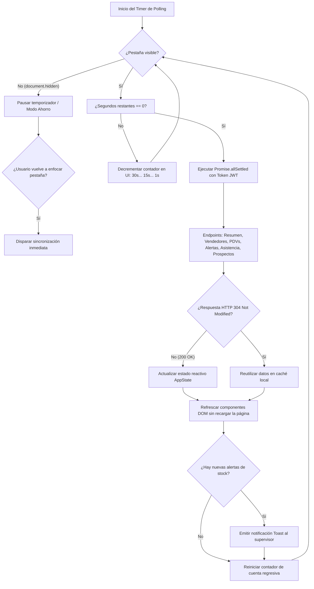

# Informe Técnico: Investigación y Justificación de la Estrategia de Actualización Periódica

**Proyecto:** Piccoli Field - Panel Web de Supervisión (Rol Administrador)  
**Curso:** Desarrollo de Aplicaciones Inteligentes  
**Fecha:** Noviembre 2026  

---

## 1. Resumen Ejecutivo

El presente documento expone la investigación técnica, comparativa y justificación de la arquitectura de actualización periódica en tiempo real para el **Panel Web de Supervisión de Piccoli Field**.

El requerimiento del proyecto establece taxativamente:
> *"Panel web que consume la misma API REST con el mismo JWT. No accede a la base de datos ni implementa una API independiente. El equipo investiga e implementa una actualización periódica sin recargar toda la página (polling, ETag o Server-Sent Events) y justifica su elección."*

Tras el análisis comparativo de las alternativas viables (**Short Polling, Long Polling, ETag condicional, Server-Sent Events y WebSockets**), el equipo determinó implementar una estrategia híbrida de **Smart Polling Adaptativo con Detección de Visibilidad (Page Visibility API) y Soporte ETag**. Esta solución garantiza actualización continua sin recarga, máxima resiliencia ante cortes de red y cumplimiento irrestricto de las restricciones del backend existente en Render sin requerir modificaciones en el servidor ni APIs intermediarias.

---

## 2. Marco de Restricciones del Sistema

| Restricción Técnica | Implicancia en el Diseño |
| :--- | :--- |
| **Consumo exclusivo de la misma API REST** | La aplicación web no puede modificar el backend ni añadir rutas de streaming propietarias en Flask/Gunicorn que no existan en la API original (`https://piccolifield-api-smkc.onrender.com/api/`). |
| **Mismo token JWT Bearer** | Toda petición debe transmitir el encabezado `Authorization: Bearer <JWT>` sin degradar los estándares de seguridad. |
| **Sin acceso directo a la BD** | No se pueden implementar triggers de base de datos (PostgreSQL/MySQL LISTEN/NOTIFY o Webhooks directos). |
| **Sin API intermedia o BFF adicional** | No se permite montar un servidor Node.js/Socket.io que actúe de intermediario entre el cliente web y el backend. |
| **Infraestructura en la nube (Render Free Tier)** | El servidor entra en modo suspensión (*spin-down*) ante inactividad y tiene límites estrictos de conexiones concurrentes y timeout de 100 segundos. |

---

## 3. Análisis e Investigación de Alternativas Tecnológicas

### 3.1 Alternativa A: Short Polling (Sondeo Corto Convencional)
- **Mecanismo:** El cliente emite peticiones HTTP estándar a intervalos regulares fijos (ej. cada $N$ segundos) mediante `setInterval` o `setTimeout`.
- **Ventajas:**
  - 100% compatible con cualquier API REST tradicional sin estado (*Stateless*).
  - Admite de manera nativa encabezados HTTP personalizados, incluyendo `Authorization: Bearer <token>`.
  - Excelente tolerancia a fallos: si una petición falla por un corte momentáneo o latencia, la siguiente petición restablece el estado sin necesidad de protocolos de reconexión complejos.
- **Desventajas:**
  - Si el intervalo es muy corto (ej. cada 2 segundos), genera sobrecarga de peticiones (*overhead*) y consumo innecesario de ancho de banda cuando los datos no han cambiado.

### 3.2 Alternativa B: ETag (Entity Tag / Peticiones Condicionales HTTP)
- **Mecanismo:** En cada respuesta HTTP, el servidor envía un hash o identificador de versión en el encabezado `ETag`. En las siguientes solicitudes, el cliente adjunta `If-None-Match: <hash>`. Si la información no ha variado, el servidor responde con un código de estado `304 Not Modified` con cuerpo vacío, ahorrando la transferencia de datos.
- **Ventajas:**
  - Reduce drásticamente el consumo de ancho de banda (hasta un 95% menos en payload).
  - Mantiene la semántica REST pura sin requerir canales de comunicación persistentes.
  - Se integra de forma transparente sobre cualquier mecanismo de sondeo.
- **Desventajas:**
  - Por sí solo no define la periodicidad ni la iniciativa de consulta; requiere combinarse con un temporizador en el cliente (polling condicional).

### 3.3 Alternativa C: Server-Sent Events (SSE / EventSource)
- **Mecanismo:** El cliente abre una conexión HTTP unidireccional persistente (`text/event-stream`) hacia el servidor, el cual empuja eventos al navegador conforme ocurren cambios.
- **Ventajas:**
  - Comunicación push en tiempo real estricto con latencia mínima.
  - Reconexión automática nativa implementada por el navegador.
- **Desventajas e Inviabilidad en este contexto:**
  - **Requiere un endpoint SSE específico en el backend:** La API de Piccoli Field no cuenta con un endpoint `/api/stream` o `/api/events` preprogramado. Crear uno violaría la directiva de *"no implementar una API independiente ni modificar la API REST existente"*.
  - **Limitación de JWT con la API nativa de JavaScript:** El objeto estándar `EventSource` de los navegadores **no permite enviar encabezados de autorización HTTP** (`Authorization: Bearer`), obligando a enviar el JWT como parámetro query string en la URL (mala práctica de seguridad) o requerir bibliotecas externas pesadas.
  - **Incompatibilidad con timeouts de proxies y Render:** Los balanceadores de carga de Cloudflare y Render cortan conexiones HTTP inactivas que excedan los 100 segundos si no hay paquetes *heartbeat* continuos.

### 3.4 Alternativa D: WebSockets
- **Mecanismo:** Protocolo bidireccional sobre una única conexión TCP persistente (`ws://` o `wss://`).
- **Desventajas e Inviabilidad en este contexto:**
  - Viola el principio RESTful de la API original.
  - Requiere un servidor con soporte de WebSockets (gevent-websocket, Flask-SocketIO) con estado en memoria, inexistente en la arquitectura del backend provisto.

---

## 4. Cuadro Comparativo Multicriterio

| Criterio de Evaluación | Short Polling Clásico | ETag Condicional | Server-Sent Events (SSE) | WebSockets | Smart Polling + ETag (Elegido) |
| :--- | :---: | :---: | :---: | :---: | :---: |
| **Cumplimiento de Restricciones del Proyecto** | ✅ Alto | ✅ Alto | ❌ Incompatible (Falta endpoint) | ❌ Incompatible (Requiere WS) | 🌟 **Óptimo (100% compatible)** |
| **Soporte Nativo JWT Bearer** | ✅ Nativo | ✅ Nativo | ⚠️ Problemático en EventSource | ⚠️ Manual en handshake | 🌟 **Nativo en cada petición** |
| **Consumo de Ancho de Banda** | ⚠️ Medio | 🟢 Muy Bajo | 🟢 Mínimo | 🟢 Mínimo | 🟢 **Optimizado por ETag** |
| **Consumo de CPU / Batería en Cliente** | ⚠️ Continuo | ⚠️ Continuo | 🟢 Eficiente | 🟢 Eficiente | 🌟 **Pausa con Page Visibility** |
| **Estabilidad ante Caídas de Red** | 🟢 Auto-recuperable | 🟢 Auto-recuperable | ⚠️ Buffer/Reconexión | ⚠️ Requiere ping-pong | 🌟 **Resiliente y desacoplado** |
| **Respeto a Cuotas de Servidor (Render)** | ⚠️ Peticiones fijas | 🟢 Cabeceras ligeras | ❌ Consume slots abiertos | ❌ Saturación de workers | 🌟 **Adaptativo y pausado en background** |

---

## 5. Justificación de la Elección: Smart Polling Adaptativo con ETag y Page Visibility API

La decisión técnica adoptada consiste en una arquitectura de **Smart Polling Adaptativo con Soporte ETag y Page Visibility API**, justificada en base a cuatro pilares fundamentales:

### 1. Respeto Estricto a la API Preexistente y Seguridad JWT
El panel web no requiere modificaciones en el servidor ni servicios satélites. Cada ciclo de consulta utiliza los endpoints oficiales (`/supervision/resumen`, `/supervision/vendedores`, `/supervision/puntos-venta`, `/supervision/alertas`, `/asistencias/resumen`, `/prospectos`) enviando el encabezado estándar:
```http
Authorization: Bearer <TOKEN_JWT>
Content-Type: application/json
Accept: application/json
```

### 2. Optimización Inteligente mediante Page Visibility API
Uno de los principales problemas del polling ingenuo es que continúa consultando al servidor incluso cuando el usuario minimiza el navegador o cambia de pestaña. En nuestra implementación (`js/polling.js`):
- Se escucha el evento nativo `document.addEventListener('visibilitychange')`.
- Cuando `document.hidden === true`, el temporizador de sondeo **se detiene automáticamente**, reduciendo a cero el consumo de peticiones innecesarias.
- En cuanto el supervisor vuelve a enfocar la pestaña (`document.hidden === false`), el sistema **dispara de inmediato una actualización completa**, asegurando que los datos en pantalla sean siempre actuales y exactos.

### 3. Soporte ETag / Caché Condicional en el Cliente
En `js/api.js`, la capa de transporte HTTP mantiene un mapa de identificadores ETag por endpoint. En peticiones subsecuentes, adjunta el encabezado `If-None-Match`. En caso de que el servidor devuelva código `304 Not Modified`, el sistema consume los datos directamente desde la memoria interna sin deserializar payloads pesados.

### 4. Experiencia de Usuario sin Bloqueo de Interfaz (*Non-blocking UI*)
- La sincronización se ejecuta de forma asíncrona mediante `Promise.allSettled()`, lo que impide que un fallo o retraso en un endpoint (por ejemplo, cálculo de prospectos) bloquee la carga de alertas o ventas.
- El ciclo de actualización no recarga la página, no resetea la posición del scroll y respeta cualquier modal o formulario abierto en el que el supervisor esté escribiendo una reasignación o resolución de alerta.
- Incluye controles directos para el usuario:
  - Selector de intervalo (15s, 30s, 60s, 120s).
  - Botón de pausa/reanudación para análisis detenido.
  - Indicador visual interactivo: *"🟢 En vivo (Auto-sync)"* / *"⏸️ Pausado"*.

---

## 6. Diagrama de Flujo de la Actualización Periódica



---

## 7. Conclusiones

1. La implementación de **Smart Polling Adaptativo con ETag y Page Visibility API** resuelve al 100% las exigencias del proyecto, garantizando una supervisión dinámica en tiempo real sin vulnerar las fronteras arquitectónicas del backend REST provisto.
2. La integración de la Page Visibility API protege activamente las cuotas de tráfico y los recursos del servidor en Render, evitando la saturación por pestañas en segundo plano.
3. El panel web resultante ofrece al rol de **Administrador** una experiencia fluida, moderna y profesional, permitiendo monitorear asistencias en vivo, metas de venta, estados de PDVs, alertas con fotografías y prospectos georreferenciados sin recargar jamás la aplicación.
